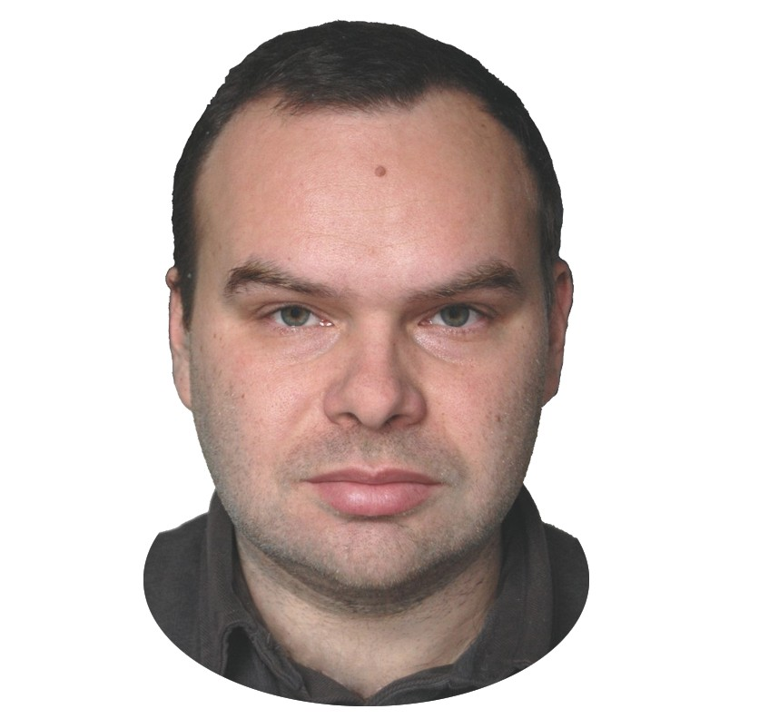

# Михайло Висоцький

Михайло Володимирович Висоцький (народився 1984 року) — український фізик, кандидат фізико-математичних наук, доцент кафедри електрофізики радіофізичного факультету Київського національного університету імені Тараса Шевченка, активний популяризатор науки та автор YouTube-каналу [«Михайло Висоцький: науково-популярні лекції»](https://www.youtube.com/@scientific_image) (матеріали якого стали основою для побудови цього ресурсу, див. [Про проєкт](../../pages/about.md)). Його наукові дослідження охоплюють ефекти когерентності та випромінювання при каналюванні частинок, квантовий ефект Зенона, взаємодію нейтронів з речовиною, а також низькотемпературний термоядерний синтез (LENR). У науково-популярних лекціях детально розглядає фундаментальні проблеми сучасної фізики, зокрема принципи роботи та історію [прискорювачів частинок](../concepts/pryskoriuvachi-chastynok.md), будову [Великого адронного колайдера](velykyi-adronnyi-kolaider.md), природу простору-часу, межу причинності та надсвітлові явища (див. [Надсвітлові явища](../concepts/nadsvitlovi-yavyshcha.md)), термодинаміку складності та розв'язання парадоксу виникнення космічного порядку (див. [Ентропія та парадокс космічного порядку](../concepts/entropiia.md)), природу й термодинаміку [чорних дір](../concepts/chorni-diry.md), а також методологію демаркації науки й викриття псевдофізичних спекуляцій (див. [Псевдонаука](../concepts/psevdonauka.md)).

## Огляд (Overview)

Михайло Висоцький закінчив радіофізичний факультет КНУ ім. Тараса Шевченка у 2007 році. У 2011 році захистив кандидатську дисертацію на тему «Особливості когерентних та нелінійних процесів при взаємодії рухомих заряджених та нейтральних частинок з упорядкованими середовищами» (науковий керівник — проф. І. О. Анісімов). З 2010 року працює на кафедрі електрофізики, викладає семінари з прикладної фізики та веде практикуми з механіки, молекулярної фізики, коливань, електрики та атомної фізики.

Він є співавтором понад 55 наукових праць у провідних міжнародних та вітчизняних виданнях. Багато досліджень виконано у співавторстві з видатним фізиком Володимиром Івановичем Висоцьким (V. I. Vysotskii), який також досліджує проблеми ядерної фізики, квантової механіки та низькотемпературного термоядерного синтезу. У межах популяризації фізики прискорювачів провів огляд світових прискорювальних центрів та лабораторії FREIA Університету Уппсали (Швеція).

## Ключові деталі / Підтеми

- **Ефекти когерентності та тандемний лазер**: Дослідив радіаційні та нелінійні процеси під час каналювання різних типів частинок. Вперше побудував теорію повного ефекту Допплера в області критичних параметрів, на основі якої запропонував нову схему тандемного лазера на рухомих частинках. У цій системі можливе випромінювання великої кількості фотонів під час послідовних переходів у межах однієї пари рівнів з перетворенням кінетичної енергії частинки в когерентне лазерне випромінювання.
- **Квантовий ефект Зенона**: Спільно з В. І. Висоцьким дослідив фундаментальні передумови реалізації квантового ефекту Зенона (ефекту уповільнення розпаду або квантового переходу системи під впливом частих вимірювань/спостережень) у мікрохвильовому та оптичному діапазонах.
- **Низькотемпературний термоядерний синтез (LENR)**: Досліджує механізми прискорення та оптимізації ядерних реакцій у невпорядкованих мішенях (наприклад, за допомогою адаптивного каналювання низькоенергетичних частинок у графенових плівках), а також саморегульований спалаховий ядерний синтез у стаціонарній намагніченій низькотемпературній плазмі. Розглядав LENR як можливе вирішення космологічної проблеми літію.
- **Популярна фізика прискорювачів**: Прочитав детальний лекційний курс про фізичні принципи прискорення (дифракційна межа, довжина хвилі де Бройля), еволюцію прискорювачів від трубок Крукса й генераторів Кокрофта — Волтона до сучасних колайдерів (ВАК, ESS, FCC), а також їхнє прикладне застосування в медицині та промисловості.
- **Боротьба з псевдофізикою та детектор демаркації**: У ґрунтовній лекції «Магія наукових слів: як із фізики роблять псевдонауку» (2026) сформулював детектор демаркації з 5 запитань для критичного аналізу заяв у медіа, розвінчав антинаукові міфи про [торсіонні поля](../concepts/torsionni-polia.md), [ефіродинаміку](../concepts/efirodynamika.md), [вічні двигуни та енергію вакууму](../concepts/vichnyi-dvyhun-ta-enerhiia-vakuumu.md), безпаливний рушій [EmDrive](../concepts/emdrive.md), поняття «[біополя](../concepts/biopole.md)» та спекуляції на тему [квантового містицизму](../concepts/kvantovyi-mystytsyzm.md).
- **Парадокс космічного порядку та термодинаміка Всесвіту**: У лекції «Парадокс космічного порядку» (2026) розкрив фізичні механізми виникнення складності у Всесвіті в умовах дії другого закону термодинаміки. Пояснив статистичну природу формули Больцмана ($S = k_B \ln W$), відкритість термодинамічних систем, від'ємну теплоємність самогравітаційних систем за теоремою віріалу, критерій Джинса, термодинаміку [чорних дір](../concepts/chorni-diry.md) (формула Бекенштейна — Гокінга, голографічний принцип), механізм підтримання життя на Землі через скидання ентропії у холодний космос (20-кратний надлишок випромінених фотонів), квантове випаровування чорних дір та неминучість теплової смерті Всесвіту.
- **Вибрані наукові праці**:
  1. *Застосування адаптивного каналювання низькоенергетичних частинок у графеновій плівці над мішенню для оптимізації прискореного ядерного синтезу у невпорядкованих мішенях* (Vysotskii, V.I., Vysotskyy, M.V., Bartalucci, S., 2024, Fusion Science and Technology).
  2. *Саморегульований спалаховий ядерний синтез у стаціонарній намагніченій низькотемпературній плазмі* (Vysotskii, V.I., Vysotskyy, M.V., 2023, Fusion Science and Technology).
  3. *Кореляційний метод 3D-детектування віддалених джерел гамма-випромінювання та нейтрино за допомогою інтерферометрії інтенсивностей* (Vysotskii, V.I., Rusov, V.D., Zelentsova, T.N., Vysotskyy, M.V., Smolyar, V.P., 2023, Nuclear Technology).
  4. *Фундаментальні передумови реалізації квантового ефекту Зенона у мікрохвильовому та оптичному діапазонах* (Vysotskii, V.I., Vysotskyy, M.V., 2022, European Physical Journal D).
  5. *Пошук корельованих квантових станів у ядерних реакціях: перші результати експериментального тесту* (Bartalucci, S., Vysotskii, V.I., Vysotskyy, M.V., 2022, Journal of Condensed Matter Nuclear Science).
  6. *LENR-рішення космологічної проблеми літію* (Vysotskii, V.I., Vysotskyy, M.V., Bartalucci, S., 2022, Journal of Condensed Matter Nuclear Science).
  7. *Каналювання заряджених частинок поблизу поверхні напівпровідників та провідних кристалів* (Vysotskii, V.I., Vysotskyy, M.V., Maksyuta, N.V., 2021, Journal of Surface Investigation).
  8. *Гарячий лазерний синтез чи низькотемпературні ядерні реакції? Аналіз та сучасні перспективи перших експериментів з лазерного термоядерного синтезу* (Vysotskii, V.I., Vysotskyy, M.V., Kornilova, A.A., 2021, Radioelektronika, Nanosistemy, Informacionnye Tehnologii).

## Джерела та посилання

- [Висоцький Михайло Володимирович](../../raw/2026-07-14/mykhailo-vysotskyy.md) — Першоджерело біографії та списку праць на сайті кафедри електрофізики КНУ.
- [Як створюють неіснуюче. Фізика прискорювачів. Науково-популярна лекція.](../../raw/2026-09-10/physics-of-particle-accelerators.md) — Лекція про принципи роботи, історію розвитку та застосування прискорювачів частинок.
- [Магія наукових слів: як із фізики роблять псевдонауку](../../raw/2026-10-10/mahiia-naukovykh-sliv-yak-iz-fizyky-roblyat-psevdonauku.md) — Лекція про механізми виникнення псевдофізики, мову науки та захист від наукоподібних містифікацій.
- [Парадокс космічного порядку. Науково-популярна лекція](../../raw/2026-10-29/paradoks-kosmichnoho-poriadku.md) — Лекція про уявний парадокс виникнення космічного порядку, формулу Больцмана, термодинаміку гравітації, чорні діри та баланс ентропії біосфери Землі.
- [Прискорювачі частинок](../concepts/pryskoriuvachi-chastynok.md) — Опис класифікації та будови прискорювальних установок.
- [Великий адронний колайдер](velykyi-adronnyi-kolaider.md) — Найбільший у світі колайдер ЦЕРН.
- [Псевдонаука](../concepts/psevdonauka.md) — Систематизація ознак псевдонауки та розроблений Михайлом Висоцьким детектор з 5 запитань.
- [Науковий метод](../concepts/naukovyi-metod.md) — Філософія та інструменти наукового пізнання.
- [Торсіонні поля](../concepts/torsionni-polia.md) — Розвінчання міфу про торсіонні генератори.
- [Ефіродинаміка](../concepts/efirodynamika.md) — Критика відродження світлоносного ефіру.
- [Вічний двигун та енергія вакууму](../concepts/vichnyi-dvyhun-ta-enerhiia-vakuumu.md) — Фізичний аналіз неможливості вічного руху з вакууму.
- [EmDrive](../concepts/emdrive.md) — Спростування безпаливного мікрохвильового рушія.
- [Біополе](../concepts/biopole.md) — Аналіз терміну та подвійні сліпі тести.
- [Квантовий містицизм](../concepts/kvantovyi-mystytsyzm.md) — Фізичне значення спостереження та декогеренція.
- [Лазери](../concepts/lazery.md) — Спільний науковий напрям: тандемний лазер на рухомих частинках, когерентне лазерне випромінювання.
- [Сучасна (квантова) картина світу](../concepts/kvantova-kartyna-svitu.md) — Контекст квантових ефектів: квантовий ефект Зенона, корпускулярно-хвильовий дуалізм.
- [Радіоактивність](../concepts/radioaktyvnist.md) — Контекст ядерних реакцій: низькотемпературний ядерний синтез (LENR), детектування гамма-випромінювання та нейтрино.
- [Ентропія та парадокс космічного порядку](../concepts/entropiia.md) — Статистична ентропія Больцмана, термодинаміка гравітаційних систем і баланс ентропії Землі.
- [Чорні діри](../concepts/chorni-diry.md) — Ентропія Бекенштейна — Гокінга, голографічний принцип та квантове випаровування чорних дір.
